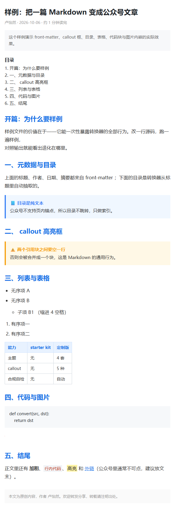

# wechat-publisher · 公众号排版器

**一句话：输入 Markdown / Word，输出可以直接粘贴进微信公众号编辑器的合规 HTML。**

<p align="left">
  
  
  
  
  
  <a href="CHANGELOG.md"></a>
</p>

---

## 解决什么问题

写公众号最耗时间的不是写字，是**排版**。

**没有这个工具之前**，常见的三条路都不舒服：

| 做法 | 痛点 |
|---|---|
| 公众号后台富文本编辑器手排 | 每篇文章重新排一遍；改一个字号要全篇点 |
| 第三方排版网站（135、秀米…） | 粘贴进去再复制出来，样式被二次加工；会员墙；内容上传到别人服务器 |
| Word → 复制粘贴 | 样式几乎全丢，表格和代码块尤其惨 |

**有了这个工具之后**：文章用 Markdown 写（版本可管、AI 可生成、跨平台），一条命令产出 HTML，浏览器打开 → 全选 → 粘贴 → 发布。排版规则（间距、字号、配色）固化在代码里，20 篇文章一个样。

它和「通用 Markdown → HTML 转换器」的区别在于**输出必须能在公众号编辑器里活下来**——而公众号会删掉或改写很多东西：

| 公众号不允许 | 后果 | 本项目的处理 |
|---|---|---|
| `<style>`、`<script>`、`<link>` | 整段被删，样式全丢 | 全部 inline CSS，零外部依赖 |
| `<h1>` | 被改写成标题样式，与正文冲突 | 自动降级为 `<h2>` |
| `<div>` | 部分场景被剥壳 | 用 `<section>` / `<p>` / `<span>` |
| `class` / `id` | 被清空 | 输出里不出现这两个属性 |
| SVG / data:image/svg+xml | 保存时丢失 | 拒绝内嵌并告警 |
| MathJax / KaTeX | `<script>` 被删，公式变原文 | 公式预渲染成 PNG 内嵌（可选） |

这些规则不是靠肉眼看，而是写成了可执行的检查器 `scripts/wechat_check.py`，每次转换后自动跑。

---

## 快速开始

### 安装

不需要 `pip install`。整个项目只用 Python 标准库。

```bash
git clone https://github.com/<你的用户名>/wechat-publisher.git
cd wechat-publisher
python scripts/convert_to_wechat.py --list-themes   # 自检式运行，应打印 4 个主题
```

环境要求：**Python 3.8+**（实测环境 Python 3.13.14 / Windows 11，Linux/macOS 未实测）。

### 使用

```bash
# 1. 最简：一条命令
python scripts/convert_to_wechat.py examples/sample_article.md out.html

# 2. 常用：指定主题 + 自动目录 + 作者
python scripts/convert_to_wechat.py 我的文章.md out.html --theme accent --toc --author 你的名字

# 3. 批量：一个目录的全部 .md → 一个输出目录（附 index.html 索引页）
python scripts/convert_to_wechat.py ./articles ./out --batch

# 4. 只做合规体检（不转换）
python scripts/wechat_check.py out.html

# 5. 跑 20 项能力自检
python scripts/selftest.py
```

然后：**浏览器打开 `out.html` → `Ctrl+A` 全选 → `Ctrl+C` 复制 → 粘贴进 mp.weixin.qq.com 编辑器 → 手机上预览一次 → 发布**。

`--strict`：合规自检发现硬错误就以非 0 退出（适合接进 CI）。全部参数见 `python scripts/convert_to_wechat.py --help`。

---

## 示例

### 输入

`examples/sample_article.md`（节选，完整文件见仓库）：

```markdown
---
title: 样例：把一篇 Markdown 变成公众号文章
author: 卢怡然
theme: accent
toc: true
---

# 开篇：为什么要样例

## 一、元数据与目录

> [!NOTE] 目录是纯文本
> 公众号不支持页内锚点，所以目录不跳转，只做索引。

## 三、列表与表格

| 能力 | starter kit | 定制版 |
|------|-------------|--------|
| 主题 | 无 | 4 套 |
| 合规自检 | 无 | 自动 |
```

### 输出

终端会打印一份「转换 + 体检」报告：

```text
✅ 已生成 examples\sample_output.html
   解析引擎：lite(零依赖)　主题：accent　格式：wechat
   合规自检：通过
     [提醒] 正文含 1 个外链 —— 公众号正文通常不允许跳转外部域名，建议把链接放到「阅读原文」或文末
   统计：553 字 / 图 1 张 / h2 7 / h3 0 / 表格 1
```

产物 `examples/sample_output.html` 里没有任何 `class` / `id` / `<style>` / `<h1>`，样式全部写在 `style=""` 上。同一份输入的 JSON 报告在 `examples/sample_report.json`。

浏览器效果（`docs/images/demo.png`）：



### 输入 → 输出对照速查

| 你写 | 你得到 |
|---|---|
| `# 标题` | 居中加粗的大标题（`<h2>`） |
| `> [!NOTE] 小标题` + `> 正文` | 📘 带底色和左边框的知识点框 |
| `:::warning 注意` … `:::` | ⚠️ 多段落警示框 |
| `==高亮文字==` | 荧光笔底色高亮 |
| `` | base64 内嵌（换电脑粘贴不丢图） |
| `$E=mc^2$` | 200 DPI 白底 PNG 内嵌（需 matplotlib，无则降级为红字并告警） |
| `--toc` | 文章开头自动生成目录 |

---

## 项目结构

```text
wechat-publisher/
├── README.md
├── SKILL.md                     # 给 AI Agent 用的技能主指令（可直接安装到 Claude/WorkBuddy）
├── LICENSE                      # MIT
├── CHANGELOG.md
├── CONTRIBUTING.md
├── AI_LOG.md                    # AI 使用日志（哪个环节用了 AI、哪个环节手写及原因）
├── ATTRIBUTION.md               # 拿来说明：借鉴了谁、改了什么
├── .gitignore
├── .github/
│   ├── workflows/ci.yml         # 三平台 × 三版本自动跑自检
│   ├── ISSUE_TEMPLATE/          # bug / feature 模板
│   └── PULL_REQUEST_TEMPLATE.md
├── scripts/
│   ├── convert_to_wechat.py     # CLI 主入口：解析 → 渲染 → 内联 → 自检
│   ├── md_lite.py               # 零依赖 Markdown 解析器（自带引擎，可替代 markdown 库）
│   ├── themes.py                # 4 套主题 + 样式键覆盖
│   ├── typography.py            # 中文排版（中英间距、标点、省略号）
│   ├── wechat_check.py          # 公众号合规检查器
│   ├── math_render.py           # LaTeX → PNG（matplotlib mathtext，不需要装 LaTeX）
│   └── selftest.py              # 20 项能力自检（可当 eval 用）
├── references/
│   ├── wechat_restrictions.md   # 公众号 HTML 限制规则清单
│   ├── wechat_styles.md         # 各主题的 inline CSS 取值
│   ├── capabilities.md          # 全部语法与主题自定义方法
│   └── troubleshooting.md       # 粘贴后排版丢失的排查顺序
├── assets/article_template.md   # 带 front-matter 与全部语法的文章模板
├── examples/                    # 输入样例、输出 HTML、JSON 报告
├── tests/test_smoke.py          # 独立冒烟测试（不需要 pytest 也能跑）
├── tools/render_readme.py       # 把 README 渲染成 HTML，用于截图/本地预览（开发用，需 markdown 库）
└── docs/
    ├── architecture.md          # 管线图：每一步的输入输出
    ├── AAR.md                   # 复盘：哪里翻车、怎么改的
    ├── official-evidence.md     # 公众号限制规则的官方原文摘录与口径冲突裁定
    └── images/
```

---

## 技术栈

- **语言**：Python 3.8+，只用标准库（`argparse` / `re` / `pathlib` / `base64` / `json` / `dataclasses`）
- **框架**：无。它不是 Web 应用，是一个 CLI + 一组可被 import 的函数
- **可选依赖**（缺了就降级，不会崩）：
  - `markdown` + `beautifulsoup4` — 走成熟解析器路径（缺失时用自带 `md_lite`）
  - `python-docx` — 需要处理 `.docx` 输入时
  - `matplotlib` — 需要渲染数学公式时（用自带 mathtext，**不需要装 LaTeX**）
- **AI 集成**：`SKILL.md` 让 Claude / WorkBuddy 这类 Agent 直接调用本项目的脚本；项目本身不调用任何在线模型 API，**离线可跑**

### 依赖策略（和常见做法不同）

很多工具会在首次运行时静默 `pip install`，改动用户环境。本项目**绝不自动安装**：

| 情况 | 行为 |
|---|---|
| 有 `markdown` + `bs4` | 库路径（CommonMark 更严谨） |
| 没有 | 自动回退 `md_lite`，**流程不断** |
| 两条路径的产物 | selftest 有断言：同一输入**字节一致** |
| 缺 `matplotlib` | 公式降级为红字等宽文本 + 明确告警，**不假装渲染成功** |
| 缺 `python-docx` 却喂了 `.docx` | 报错信息里直接给出 `pip install python-docx` |

---

## 质量保证

```bash
python scripts/selftest.py        # 20 项能力自检
python tests/test_smoke.py        # 冒烟测试（无 pytest 依赖），8/8
```

实测两种环境的口径**必须分开报**，否则数字对不上：

| 环境 | selftest | 冒烟测试 | 掉的项 |
|---|---|---|---|
| 干净机器（无任何第三方库，Python 3.13.14） | **18/20** | **8/8** | 2 项是「拿 markdown 库当参照物」的双引擎对比，无库时不可执行 |
| 装了 `markdown`/`bs4`/`matplotlib`/`python-docx` 的环境 | **20/20** | **8/8** | — |

> 这不是「失败」，是设计如此：没有参照物就不该假装对比过。降级路径本身在零依赖环境下另有 18 项断言覆盖。

---

## AI 生成说明

本项目的绝大部分代码由 AI 辅助生成，但我对每一行都做了运行验证；README 里的每个数字都来自实际执行的输出。详细记录（包括**手写部分及原因**、被 AI 写错后修掉的 bug）见 [AI_LOG.md](./AI_LOG.md)，复盘见 [docs/AAR.md](./docs/AAR.md)。

简单说：AI 负责「写第一版」和「自查」，人负责「定验收标准」和「不信没跑过的结论」。

## 借鉴来源

本项目基于 WorkBuddy / Claude 官方 starter kit 二次开发，并参考了公众号官方接口文档与若干开源实现，逐条标注在 [ATTRIBUTION.md](./ATTRIBUTION.md)。**没有一段代码是「看起来像」就抄进来的**——凡是借来的，都写了来源、改了什么、为什么改。

## 参与贡献

欢迎提 Issue 和 PR。请先看 [CONTRIBUTING.md](./CONTRIBUTING.md)（含「怎么加一套新主题」的分步示例）。

## License

[MIT](./LICENSE) © 2026 卢怡然
